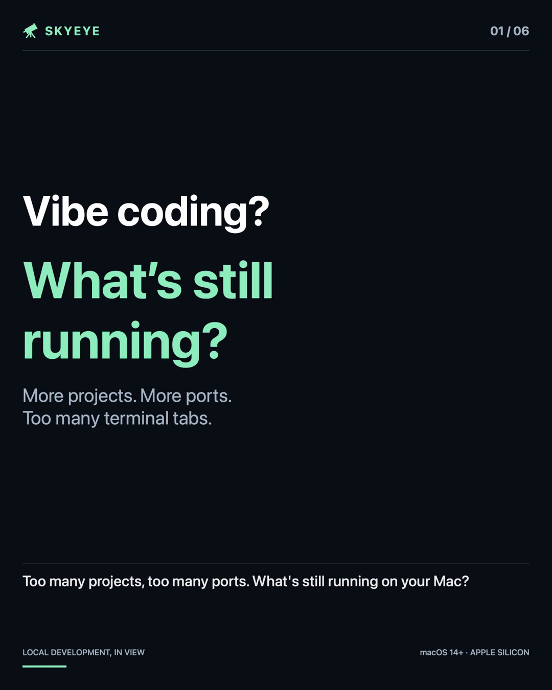
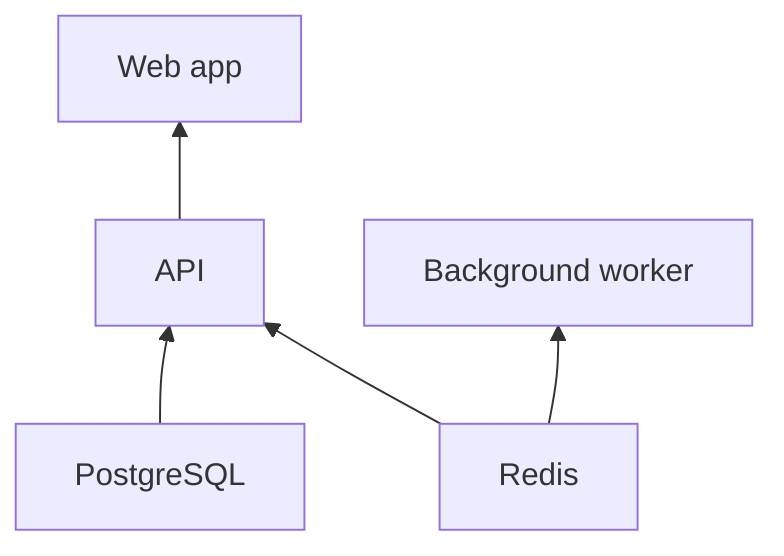

# SkyEye, for humans 🔭

**See what's running on your Mac. Start your stack from the menu bar.**

Your web app, API, database, and background worker can live in different projects and terminal tabs. SkyEye brings them into one place: what's running, which port it uses, what its logs say, and what it depends on.

Built natively for macOS. Open source. Works with your terminal and AI coding agents, too.

**[Watch the demo](docs/videos/skyeye-demo.mp4)** · **[Try it](#try-it-on-your-mac)** · **[Connect your agent](#let-your-agent-help)**

## Take a 35-second tour

<a href="docs/videos/skyeye-demo.mp4"></a>

**[▶ Watch the demo with narration and captions](docs/videos/skyeye-demo.mp4)**

See the service list, live logs, dependency canvas, and an example of registering a service through an AI agent. The video uses demo services and timed actions in a dedicated capture app built from SkyEye's native views.

## Your services, at a glance


*Example services in the SkyEye menu.*

| When you want to… | SkyEye helps you… |
| --- | --- |
| Find what's still running | See service status, ports, CPU, and memory in one place. |
| Bring up a project | Start a service and its dependencies, or start a whole group. |
| Understand a failure | Open the service's logs from its card. |
| Watch something you started elsewhere | Add its port as a monitor-only service, with no start command. |

Point at a service card to find its start, stop, restart, URL, logs, and edit buttons.

## See how your stack fits together


*Apps sit above their dependencies. Shared dependencies appear once.*

Drag cards to arrange the canvas. Connect services to define dependencies. For example:



**Start the web app → SkyEye starts PostgreSQL and Redis, waits for the API to become ready, then starts the web app.**

Arrows point from a dependency to the service that needs it. SkyEye uses ports and optional health checks to decide when a service is ready. If a dependency fails, the services waiting on it won't start. Stopping your web app leaves its dependencies running.

## Try it on your Mac

You'll need **macOS 14 or later, an Apple Silicon Mac, and Xcode 15.3 or later** to build from source.

```bash
git clone https://github.com/weirui828/skyeye.git
cd skyeye
./scripts/install.sh
```

The installer builds and opens SkyEye, installs it in `~/Applications`, and links its command-line tools in `~/.local/bin`.

1. Open the **telescope icon** in your menu bar.
2. Select **Add service**. Give it a name, its usual start command (for example, `npm run dev`), and its project folder. Add a port if it uses one.
3. Save, then point at the card and select **Start**.
4. Add your other services. Set dependencies in the service editor or connect them on the canvas.

**Early developer preview:** the interface can change. See the [build and installation reference](README.md#build-and-install-from-source) for more detail.

## Let your agent help

Open **Settings → AI agents**, select your agent, and copy its setup instructions. SkyEye supports service management through MCP, so a connected agent can register services, check their status, start them, and read logs.

For example, ask your connected agent:

> Register this project in SkyEye as `my-app`. Use `npm run dev`, this project folder, and port 3000.

**You approve new commands added by an agent before they run.** Keep command approval enabled in Settings → Advanced.

Prefer the terminal? After installation, with `~/.local/bin` on your PATH:

```bash
sky list
sky start my-app
sky logs my-app -f
sky stop my-app
```

## A few things to know

- **Quitting SkyEye stops the services it started by default.** You can keep them running in Settings → General.
- **Starting services when SkyEye opens is optional.** Choose selected services or all services in Settings → General.
- **Your configuration and logs stay on your Mac.** They live in your Library folders, outside this repository. Environment variables and logs can contain secrets; keep them out of public issues.

## Say hello

Found a bug or have an idea? **[Open an issue](https://github.com/weirui828/skyeye/issues)** and describe what you were trying to do. For security issues, use the [private reporting instructions](SECURITY.md).

Made by [Wei Rui](https://github.com/weirui828) · [MIT License](LICENSE) · [Full technical reference](README.md)
