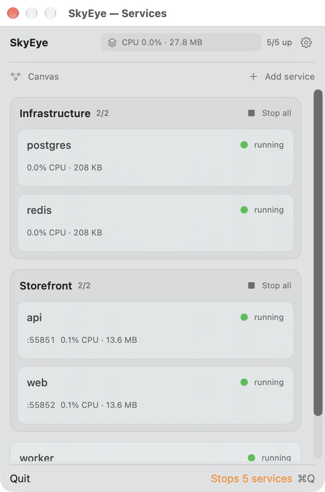
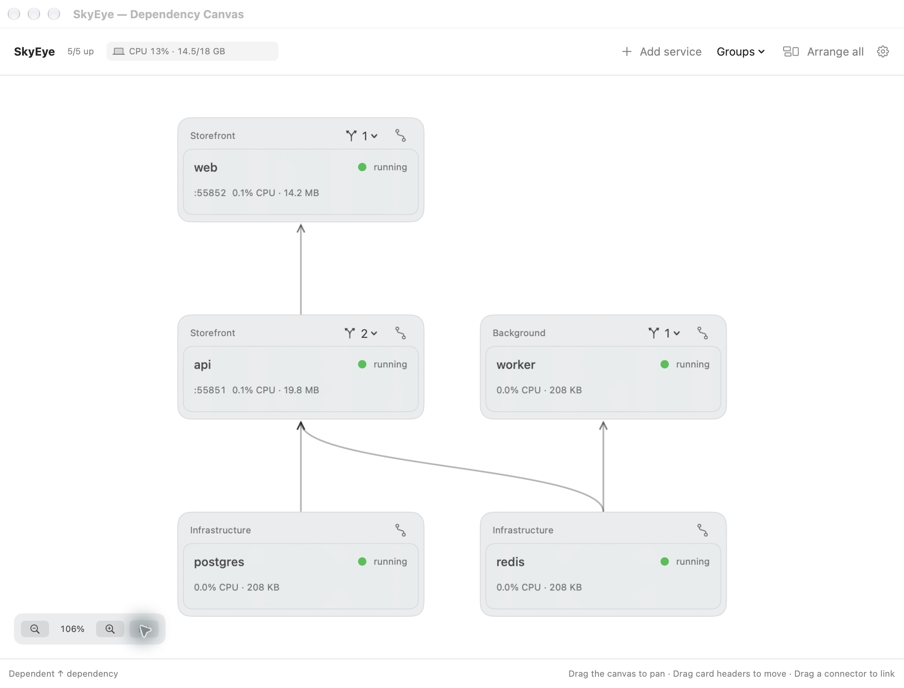

# SkyEye

> **Human? Read [HUMAN.md](HUMAN.md).** This README is for coding agents.
> The human guide has a visual overview, screenshots, and a quick start.

SkyEye manages local development services on macOS.
Start and stop services from the menu bar.
Use the canvas to see which services depend on other services.

[](https://github.com/weirui828/skyeye/actions/workflows/ci.yml)

**SkyEye is an early developer preview.** The interface can change.
Check the CI results before you use a new build.

## Requirements

- macOS 14 or later.
- An Apple Silicon Mac (M1 or later). Intel Macs are not supported.
- Xcode 15.3 or later to build from source.

A packaged app does not need Xcode.
Packaged developer previews are available on the [Releases page](https://github.com/weirui828/skyeye/releases).
They are not notarized; macOS may block downloaded copies.

## Screenshots

These screenshots use demo services.





## Build and install from source

1. Install Xcode with Swift 5.10 or later and the macOS SDK.
2. Clone this repository.

   ```bash
   git clone https://github.com/weirui828/skyeye.git
   cd skyeye
   ```

3. Run the installer.

   ```bash
   ./scripts/install.sh
   ```

4. Open the telescope icon in the menu bar.

The installer puts the app in `~/Applications`.
It also creates links for `sky` and `skyeye-mcp` in `~/.local/bin`.
If you cancel the quit prompt, the installer stops without replacing the app.

To build without installation, use these commands:

```bash
./scripts/build.sh
open build/SkyEye.app
```

## Install a packaged app

Download a packaged developer preview from the [Releases page](https://github.com/weirui828/skyeye/releases):

1. Download the DMG file.
2. Open the DMG file.
3. Drag **SkyEye.app** into **Applications**.
4. Open SkyEye from Applications.
5. Open the telescope icon in the menu bar.

CI packages are developer builds. They are not notarized.
macOS can block these downloads.

### Update the app

1. Quit SkyEye.
2. Replace the app in Applications with the new version.
3. Open the new version.

Your service definitions and logs stay in your Library folders.
SkyEye does not have an automatic updater.

## Add a service

1. Select **Add service** above the service cards.
2. Enter a name and a start command.
3. Select the working directory.
4. Enter the port, if the service uses one.
5. Select **Save**.

Point at a service card to show its action buttons.
Use these buttons to start, stop, or restart the service.
You can also open its URL, read its logs, or edit its settings.

To monitor a service without starting it, set its port and leave the command empty.
SkyEye calls this a *monitor-only service*.

## Start services when SkyEye opens

Open **Settings → General → Start with SkyEye**.
Select one option:

| Option | Result |
| --- | --- |
| None | SkyEye does not start services. This is the default. |
| Selected services | SkyEye starts the services that you select. |
| All services | SkyEye starts all services with a start command, including services added later. |

The setting applies the next time SkyEye opens.
Commands still need approval. Dependencies start first.
SkyEye uses services that are already running.
It does not start monitor-only services.

## Set service dependencies

A dependency is a service that another service needs.
For example, an API can depend on PostgreSQL.

1. Edit the API service.
2. Open the **Dependencies** tab.
3. Select the PostgreSQL service.
4. Select **Save**.

When you start the API, SkyEye starts PostgreSQL first.
It waits for the port and health check, if configured.
Then it starts the API.
If PostgreSQL fails, the API does not start.
SkyEye leaves other started dependencies running.

A service without a port counts as ready when its process starts.
A monitor-only dependency must already be running.

### Use the canvas

Select **Canvas** above the service cards.
Apps appear above their dependencies. Arrows point upward, toward the apps.
Each shared dependency appears once.

- Drag a card's top bar to move it.
- Drag the empty canvas to move the view.
- Use the zoom buttons or **Fit** to change the view.
- Select **Arrange all** to restore the automatic layout.

To add a dependency, drag its connector onto the service that needs it.
You can also select the dependency's connector, then the other service's connector.
Use a card's dependency menu to remove a connection.

SkyEye rejects dependency cycles and connections from a service to itself.
It saves card positions between launches.
Changes to dependencies move affected cards automatically.

Stopping a service leaves its dependencies running.
In the canvas, SkyEye asks before it stops a dependency with active dependent services.

## Read resource use

The status badge changes every five seconds.
It shows CPU and memory use for the computer, SkyEye, or running services.
The laptop, telescope, and stacked-box icons identify each view.
Point at the badge to pause the cycle and see its short description.

CPU readings in the badge use total computer capacity.
CPU readings on individual service cards use one core as 100 percent.

## Use the command-line tools

The source installer creates the command-line links.
For a packaged app, the links are optional.
The app and its AI agent setup work without them.

To create links for an app in Applications, run these commands:

```bash
mkdir -p "$HOME/.local/bin"
ln -sfn /Applications/SkyEye.app/Contents/MacOS/sky "$HOME/.local/bin/sky"
ln -sfn /Applications/SkyEye.app/Contents/MacOS/skyeye-mcp "$HOME/.local/bin/skyeye-mcp"
export PATH="$HOME/.local/bin:$PATH"
```

Use the actual app location if you installed it elsewhere.
Add the PATH line to your shell profile if necessary.

### Common commands

```bash
sky add api --cmd "npm run dev" --port 3000 --health /health --group shop
sky start api
sky stop api
sky start @shop
sky list
sky logs api -f
sky edit api --port 3001 --env DEBUG=1
```

For `sky add`, the current directory is the default working directory.
Use `@group` to control a group of services.
Run `sky --help` to see all commands and options.

To set dependencies from the terminal, use these commands:

```bash
sky edit api --depends-on postgres,redis
sky start api --timeout 180
sky edit api --depends-on none
```

## Connect an AI agent

1. Open **Settings → AI agents**.
2. Select your agent.
3. Copy the setup command or configuration.
4. Apply it in your agent.

SkyEye uses the installed app location in these instructions.
They do not contain a fixed username or home directory.

If `skyeye-mcp` is on your PATH, you can use these commands:

```bash
claude mcp add skyeye -- skyeye-mcp
codex mcp add skyeye -- skyeye-mcp
gemini mcp add skyeye skyeye-mcp
```

SkyEye uses the Model Context Protocol (MCP) to expose service controls.
Available tools include:

- `list_services`, `get_service`, `add_service`, and `update_service`.
- `remove_service`, `start_service`, `stop_service`, and `restart_service`.
- `get_logs` and `check_port`.

The add and update tools accept a `dependencies` list of service names.
The start tool can wait for readiness and return logs after a failure.

## Keep command approval enabled

SkyEye runs shell commands with your user permissions.
A new command from the terminal or an AI agent needs your approval.
Changes to its command, directory, or environment need approval again.
Services that you add in the app are approved when you save them.

Leave command approval enabled in **Settings → Advanced**.
Review the command before you approve it.
The local control socket accepts connections only from your user account.
It does not protect you from malicious software already running as your user.

Report security issues privately. Read the [security policy](SECURITY.md) for instructions.

## Keep services running when you quit

By default, quitting SkyEye stops the services it started.
To leave them running, enable **Settings → General → Keep services running when SkyEye quits**.
SkyEye takes control of those processes again when it next opens.

## Set log retention

Open **Settings → Logs → Retention**.
Select 1 day, 7 days, 30 days, or **Keep forever**.
The default is 7 days.

SkyEye deletes expired archives and inactive logs.
It keeps active logs.
Cleanup runs at app startup, each hour, and when you change the setting.

Logs rotate daily, on the first output after midnight.
Existing services use daily rotation after their next restart.
The log viewer and `sky logs` include recent archives.
`sky logs -f` follows the current log across rotation.

Services left running after SkyEye quits continue to write and rotate logs.
Cleanup resumes when SkyEye opens again.

## Find local data

| Data | Location |
| --- | --- |
| Service definitions and app settings | `~/Library/Application Support/SkyEye/config.json` |
| Current service log | `~/Library/Logs/SkyEye/<name>.log` |
| Archived service logs | `~/Library/Logs/SkyEye/archive/<name>/` |

These locations are outside this repository.
Git does not include them when you push the repository.
Configuration files can contain secrets in environment variables.
Do not attach configuration files or raw logs to public issues.

## Test and package

The HTTP service tests need Python 3. CI provides Python 3.12.

```bash
swift test --disable-sandbox
python3 -m unittest discover -s scripts/tests -v
./scripts/package.sh
```

The package script creates an Apple Silicon app, a DMG, a ZIP, and SHA-256 checksums.
Generated files stay under `build/`. Git ignores this directory.
The CI workflow tests the Apple Silicon build.
It creates developer packages only after the tests pass.

See [Preparing a Mac release](docs/RELEASING.md) for signing and notarization instructions.
See [Repository protection](docs/REPOSITORY-SECURITY.md) for maintainer settings.

## Maintainer and license

[Wei Rui (@weirui828)](https://github.com/weirui828) maintains SkyEye.

Copyright (c) 2026 Wei Rui. Released under the [MIT License](LICENSE).
